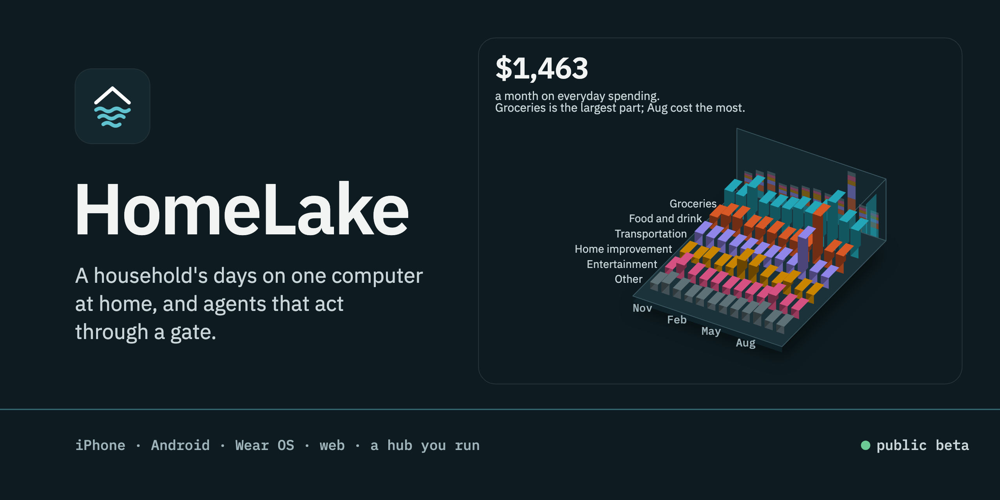

# Taylor Addison

**Senior Manager, Data Engineering at Warner Bros. Discovery**

I build data platforms and engineering teams at scale, and I stay close to the
craft through mobile systems, developer infrastructure, and on-device ML.

I started as an iOS engineer, shipped software across the screens in the living
room, followed the data those products produced, and today lead the data
platform behind Warner Bros. Discovery's streaming products, now part of
Skydance. Building end to end is how I keep my technical judgment grounded in
what teams actually have to operate.

[Portfolio](https://tayloraddison.dev) ·
[LinkedIn](https://www.linkedin.com/in/tayloraddison) ·
[Email](mailto:addisdev@gmail.com)

## Featured work

### [HomeLake](https://homelake.app)

A household's days on one computer at home. Each person's phone, watch and
linked accounts send daily summaries to a hub the household runs itself, and a
lakehouse on that hub answers questions about sleep, movement, places and money.
Agents act on it only through a gate. Public beta on iPhone, Android, Wear OS
and the web.

- The data platform at household scale: stream contracts, a lakehouse with
  governed metrics and a semantic layer, and an MCP server over it.
- Privacy by design: only the streams a person switches on, daily summaries
  rather than raw samples, kept on the household's own computer.
- Every agent action is approved, refused or run in shadow, and each can be
  explained and undone.

**Demonstrates:** data platform architecture, data contracts, native mobile on
four platforms, privacy engineering, agent safety, and self-hosted operations.

[homelake.app](https://homelake.app) ·
[Case study](https://tayloraddison.dev/apps/homelake/) ·
[Join the beta](https://homelake.app/beta)

### [Fleet Runner](https://github.com/addisdev/fleet-runner)

A shelf of old phones turned into a device lab: one queued job runs UI tests,
visual regression, battery experiments or on-device ML benchmarks across real
iOS and Android hardware, through five runners that share one tested protocol.

**Demonstrates:** distributed systems, mobile platforms, protocol design,
on-device ML evaluation, and test infrastructure.

[Source](https://github.com/addisdev/fleet-runner) ·
[Documentation](https://addisdev.github.io/fleet-runner/) ·
[Releases](https://github.com/addisdev/fleet-runner/releases)

### [Actions Runners](https://github.com/addisdev/actions-runners)

Register, supervise and observe a fleet of self-hosted GitHub Actions runners
on one Apple Silicon Mac, with a dashboard that names the drift GitHub or
launchd alone would show as healthy.

**Demonstrates:** CI/CD infrastructure, observability, macOS systems work, and
failure modeling.

[Source](https://github.com/addisdev/actions-runners) ·
[Documentation](https://addisdev.github.io/actions-runners/) ·
[Releases](https://github.com/addisdev/actions-runners/releases)

## Portfolio

**[Explore the full portfolio →](https://tayloraddison.dev)**

My career from iOS engineering to data-platform leadership, the products I have
shipped end to end, and the work behind the public projects above.
